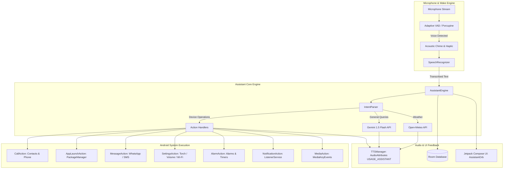

# 🌐 Siri-Style Android System Voice Assistant

[-green.svg?style=for-the-badge&logo=android)](https://www.android.com)
[](https://kotlinlang.org)
[](https://developer.android.com/jetpack/compose)
[](https://ai.google.dev)
[](https://developer.android.com/topic/architecture)
[](LICENSE)
[](SECURITY.md)

A native, hands-free Android digital voice assistant built with modern **Kotlin** and **Jetpack Compose**. Unlike traditional chatbot apps, this assistant deeply integrates with Android OS APIs to execute real hardware, app, telephony, and system operations completely hands-free.

---

## 📸 Screenshots & UI Showcase

<p align="center">
  
</p>

- **Deep Matte Black Palette**: Designed with `#0B0B0E` canvas, `#18181C` graphite cards, and clean white typography.
- **Dynamic Assistant Orb**: Audio-reactive vector particle canvas with real-time waveform reactivity, processing swirl, breathing pulse, and alert animations.
- **Live Transcripts**: Real-time conversation bubbles with intent badges and system action outcomes.

---

## ⚡ Highlights & Key Capabilities

### 1. Hands-Free Wake-Word & Calm VAD Standby
- **Activation Phrase**: `"Hey Siri"` (also supports *"Siri"*, *"Hi Siri"*, *"OK Siri"*).
- **Dual-Engine Wake Architecture**:
  - **Picovoice Porcupine**: Hardware-optimized offline keyword detection (`Porcupine.BuiltInKeyword.HEY_SIRI`) or custom `.ppn` keyword models.
  - **Adaptive Voice Activity Detection (VAD)**: Dynamic background noise floor tracking using exponential moving averages. Operates out-of-the-box with **zero** cloud dependencies and **zero** status-bar microphone flickering.
- **Headless Action Execution**: Commands such as *"Hey Siri, open WhatsApp"* or *"Hey Siri, turn on flashlight"* execute immediately in the background without forcing the assistant UI over the user's active screen.
- **Acoustic Feedback**: Instant haptic tap and confirmation chime via `ToneGenerator`.

### 2. Native Telephony & Contact Resolution
- Commands: *"Call Mom"*, *"Call Rahul"*, *"Call 9876543210"*, *"Call my father"*.
- Resolves contact numbers via Android `ContactsContract`.
- Disambiguates between multiple matching phone numbers through voice follow-up.
- Secure fallback: Uses `Intent.ACTION_CALL` when permission is granted, defaulting safely to `Intent.ACTION_DIAL`.

### 3. Dynamic Application Launcher
- Commands: *"Open WhatsApp"*, *"Open Instagram"*, *"Open YouTube"*, *"Open Spotify"*, *"Open Chrome"*.
- Dynamically queries all launchable apps on the device via `PackageManager`.
- Matches exact app titles, partial names, and system package aliases with graceful error reporting for missing apps.

### 4. Messaging Management (WhatsApp & SMS)
- Commands: *"Send a WhatsApp message to Rahul saying I will be late"*, *"Send an SMS to Mom saying I am coming home"*.
- Parses recipient and message payload, verifies target contact details, reads the drafted message aloud, and dispatches via standard Android intents.

### 5. System Settings & Hardware Control
- **Flashlight**: Direct toggle via `CameraManager.setTorchMode` with zero UI disruption.
- **Media Volume**: Seamless volume adjustment via `AudioManager`.
- **System Panels**: Voice shortcuts to Android 10+ settings slices (`Settings.Panel.ACTION_WIFI`, Bluetooth, Airplane mode, Sound settings).

### 6. Alarms, Timers & Clock
- Commands: *"Set an alarm for 6 AM"*, *"Set a timer for 10 minutes"*, *"Show my alarms"*.
- Integrates with Android `AlarmClock` intents with `EXTRA_SKIP_UI` for instantaneous scheduling.

### 7. Notification Reading
- Commands: *"Read my notifications"*, *"Do I have any WhatsApp messages?"*.
- Integrated `AssistantNotificationListenerService` securely inspects active notifications and reads message content through Text-to-Speech.

### 8. Media Playback Control
- Commands: *"Play music"*, *"Pause music"*, *"Resume music"*, *"Next song"*, *"Previous song"*.
- Dispatches hardware media key events via `AudioManager`.

### 9. Natural Language & Live Weather
- **Live Weather**: Instant temperature, wind speed, and weather condition reporting powered by Open-Meteo.
- **Gemini AI Knowledge Engine**: Integrated Google Gemini 1.5 Flash for conversational queries, facts, calculations, and general knowledge.

### 10. System Default Digital Assistant
- Implements `VoiceInteractionService` and `VoiceInteractionSessionService`.
- Eligible to replace Google Assistant as the device's default digital assistant (triggerable via long-press home or power button).

---

## 🏛️ System Architecture



---

## 📂 Project Structure

```
app/src/main/java/com/siri/assistant/
 ├── voice/
 │    ├── WakeWordManager.kt       # Dual Porcupine & adaptive VAD wake-word engine
 │    ├── SpeechManager.kt         # Android SpeechRecognizer & RMS audio monitoring
 │    └── TTSManager.kt            # TextToSpeech manager with USAGE_ASSISTANT routing
 │
 ├── assistant/
 │    ├── AssistantEngine.kt       # Central state machine & headless execution coordinator
 │    ├── IntentParser.kt          # Dual-layer regex & NLU action resolver
 │    └── ConversationManager.kt   # Room database session & audit logger
 │
 ├── actions/
 │    ├── AssistantAction.kt       # Sealed class definitions & ActionResult contracts
 │    ├── CallAction.kt            # Contact lookup & phone dialer handler
 │    ├── AppLaunchAction.kt       # Dynamic PackageManager launcher with alias matching
 │    ├── MessageAction.kt         # WhatsApp & SMS composer intent handler
 │    ├── SettingsAction.kt        # Flashlight, volume, Wi-Fi, and display panel handler
 │    ├── AlarmAction.kt           # AlarmClock intents & timer scheduling
 │    ├── NotificationAction.kt    # Notification reader via NotificationListenerService
 │    └── MediaAction.kt           # Media key event dispatcher
 │
 ├── service/
 │    ├── AssistantForegroundService.kt            # Persistent background microphone service
 │    ├── AssistantNotificationListenerService.kt   # System notification interceptor
 │    ├── AssistantVoiceInteractionService.kt      # Android default digital assistant service
 │    ├── AssistantVoiceInteractionSessionService.kt
 │    └── BootReceiver.kt                         # Auto-start on boot receiver
 │
 ├── ai/
 │    └── GeminiRepository.kt      # Gemini 1.5 Flash client & live weather client
 │
 ├── contacts/
 │    └── ContactRepository.kt     # ContactsContract phone resolver
 │
 ├── data/database/
 │    ├── ConversationEntity.kt    # Room entity schema
 │    ├── ConversationDao.kt       # Database access object
 │    └── AssistantDatabase.kt     # Room database instance
 │
 ├── ui/
 │    ├── HomeScreen.kt            # Minimalist Siri UI & live transcript log
 │    ├── SettingsScreen.kt        # API keys, assistant role, & permission checklist
 │    ├── AssistantOrb.kt          # Canvas waveform & fluid glowing orb
 │    └── MainViewModel.kt         # MVVM StateFlow ViewModel
 │
 └── MainActivity.kt               # Launcher activity & assist intent router
```

---

## 🛠️ Build & Installation

### Prerequisites
- **Android Studio Ladybug (2024.2+)** or command-line Gradle.
- **JDK 17** or **JDK 21**.
- Android SDK Platform **35** (Android 15) installed.
- A physical Android device or emulator running **Android 8.0 (API 26) through Android 15 (API 35)**.

### Step 1: Clone the Repository
```bash
git clone https://github.com/Dineshv0311/siri.git
cd siri
```

### Step 2: Build the APK
```bash
# On Windows
.\gradlew assembleDebug

# On Linux / macOS
./gradlew assembleDebug
```

The compiled APK will be located at:
`app/build/outputs/apk/debug/app-debug.apk`

### Step 3: Install on Device via ADB
```bash
# Ensure your device is connected with USB Debugging enabled
adb devices

# Install APK
adb install -r app/build/outputs/apk/debug/app-debug.apk
```

### Step 4: Initial Permissions Setup
1. Launch **Siri Assistant** from your app drawer.
2. Grant runtime permissions when prompted (**Microphone**, **Contacts**, **Phone**, **Notifications**).
3. To enable notification reading: Tap **Open Settings** in the app and toggle **Siri Notification Listener** to ON.
4. *(Optional)* Set as default assistant: Go to **Settings > Apps > Default apps > Digital assistant app** and select **Siri Assistant**.

---

## 🗣️ Voice Commands Cheat Sheet

| Category | Example Voice Command | What Siri Does |
| :--- | :--- | :--- |
| **Phone Calls** | *"Hey Siri, call Mom"* | Searches contacts and dials Mom immediately. |
| **Phone Calls** | *"Hey Siri, call 9876543210"* | Directly dials the telephone number. |
| **App Launch** | *"Hey Siri, open WhatsApp"* | Directly launches WhatsApp in the foreground. |
| **App Launch** | *"Hey Siri, open Spotify"* | Launches Spotify directly. |
| **Hardware** | *"Hey Siri, turn on flashlight"* | Turns the camera LED torch on in the background. |
| **Hardware** | *"Hey Siri, turn off flashlight"* | Turns the flashlight off. |
| **Alarms** | *"Hey Siri, set an alarm for 7 AM"* | Creates an alarm in the default system Clock app. |
| **Timers** | *"Hey Siri, set a timer for 5 minutes"* | Starts a 5-minute countdown timer. |
| **Messaging** | *"Send a WhatsApp to Rahul saying I am on my way"* | Drafts message and prepares WhatsApp send intent. |
| **Messaging** | *"Send an SMS to Dad saying I arrived"* | Composes text message to Dad. |
| **Notifications** | *"Hey Siri, read my notifications"* | Reads active notifications through Text-To-Speech. |
| **Media** | *"Hey Siri, pause music"* | Pauses active media playback. |
| **Media** | *"Hey Siri, next song"* | Skips to the next music track. |
| **Weather** | *"Hey Siri, what is the weather today?"* | Fetches and speaks live local weather. |
| **AI Q&A** | *"Hey Siri, explain quantum computing"* | Answers using Gemini 1.5 Flash. |

---

## 🔒 Security & Privacy

This project strictly adheres to **Privacy-By-Design** principles:
- **No continuous audio recording or cloud streaming**: Standby VAD is computed in local memory.
- **Zero arbitrary code execution**: No shell scripts, dynamic class loaders, or root bypasses.
- **All internal components secured**: Non-exported foreground services prevent unauthorized IPC invocation.
- For complete details on threat mitigation and vulnerability reporting, see [SECURITY.md](SECURITY.md).

---

## 🤝 Contributing

Contributions, issues, and feature requests are welcome!
1. Fork the Project.
2. Create your Feature Branch (`git checkout -b feature/AmazingFeature`).
3. Commit your Changes (`git commit -m 'feat: Add AmazingFeature'`).
4. Push to the Branch (`git push origin feature/AmazingFeature`).
5. Open a Pull Request.

---

## 📄 License

Distributed under the **MIT License**. See [`LICENSE`](LICENSE) for more information.

---

<p align="center">
  Crafted with ❤️ for Android Developers & Power Users.
</p>
